# Funcionalidades de la interfaz

Recorrido breve de AdminPH por cada sección del menú. Cada bloque indica qué hace la pantalla, un ejemplo y el lugar de la captura.

Guarda las imágenes en `docs/capturas/` con el nombre que aparece debajo de cada sección. Si el archivo aún no existe, el enlace se verá roto hasta que lo agregues.

Entra con `admin@example.com` / `Admin123!` y deja seleccionado **Conjunto El Nogal** en la barra superior.

---

## 1. Inicio de sesión

El administrador ingresa con correo y contraseña. Si las credenciales son válidas y el usuario está activo, entra al panel. Desde el nombre en la barra superior puede cerrar sesión.

**Ejemplo:** Ana Martínez entra con `admin@example.com`. El usuario `inactivo@example.com` no puede entrar.

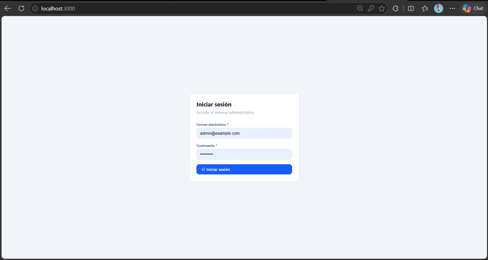

---

## 2. Menú y edificio activo

El menú izquierdo muestra solo las secciones permitidas al perfil. En la barra superior se elige el edificio de trabajo, el resto de pantallas usa ese edificio.

**Ejemplo:** el operador solo ve Panel, Edificios, Inmuebles, Inventario y Mantenimientos. El administrador cambia de El Nogal a Torre Central y el inventario pasa a ser el de esa copropiedad. Se puede cambiar entre edificios suendo superusuario o administrador de varios edificios.

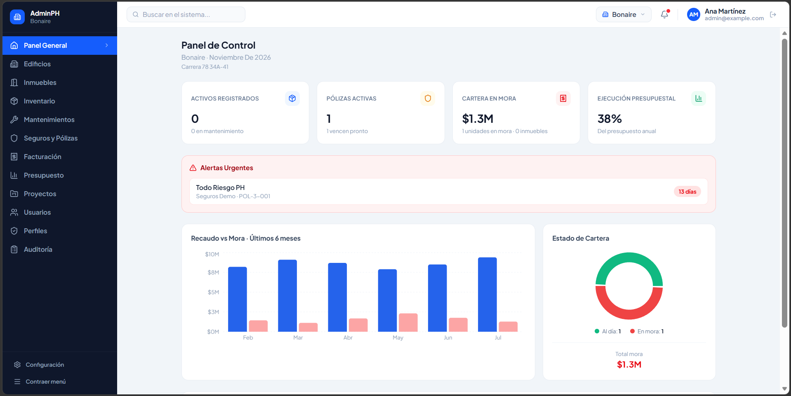
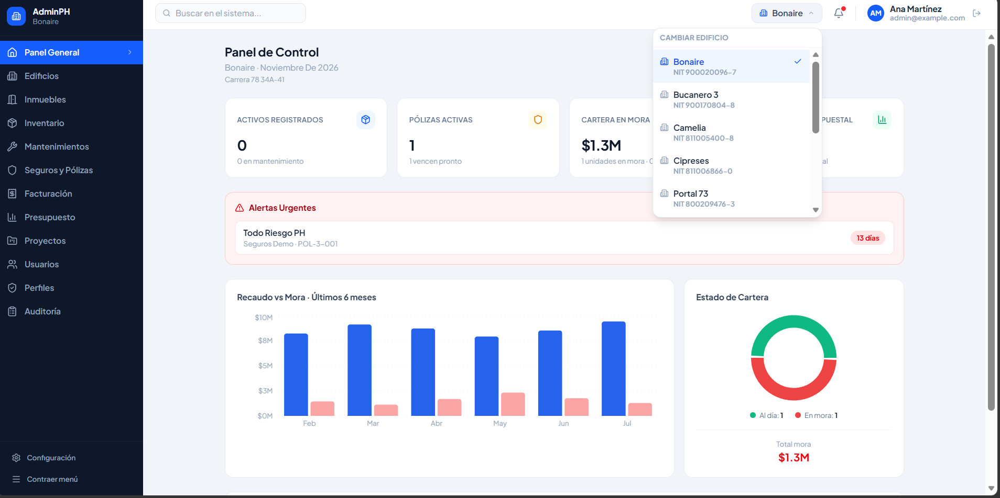

---

## 3. Panel general

Resume el edificio seleccionado: activos, pólizas, cartera en mora y ejecución del presupuesto. También muestra alertas urgentes y un vistazo del recaudo y de los mantenimientos en curso.

**Ejemplo:** en El Nogal el panel indica cuántos activos están en mantenimiento y qué unidades llevan más de 60 días en mora.

---

## 4. Edificios

Lista las copropiedades del usuario. Permite registrar una nueva, ver su detalle y actualizar datos como dirección o teléfono. El NIT no se puede repetir.

**Ejemplo:** se registra *Torre del Parque*, NIT `900222004`, Calle 45 # 12-10. Un segundo intento con el mismo NIT queda rechazado.

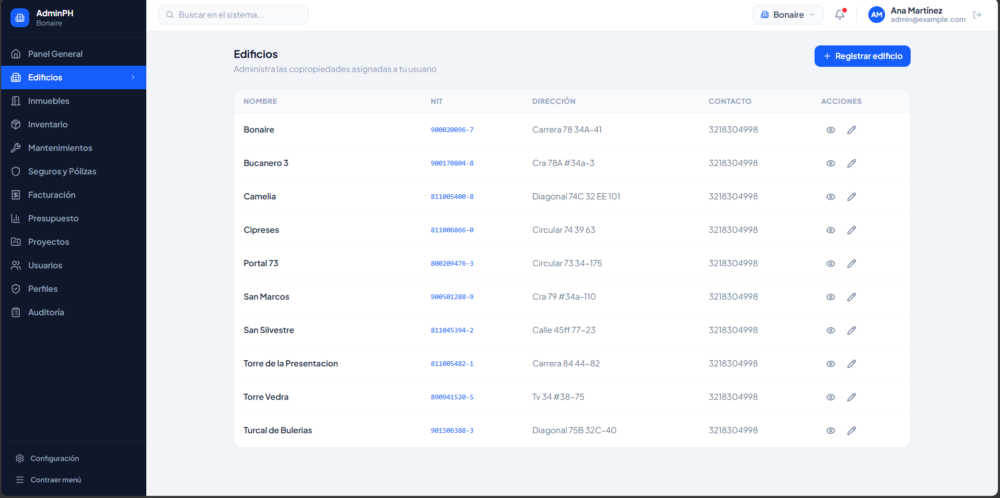

El logo de vista da detalles sobre cada edificio, mientras el lapiz permite modificar los documentos. Esta información se muestra en el pie de página.
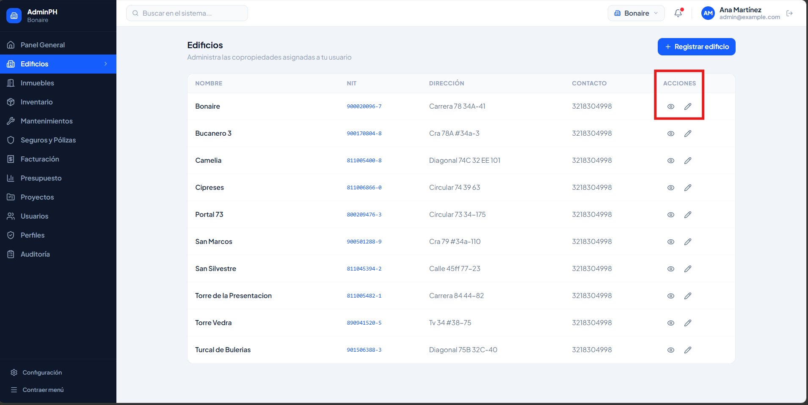

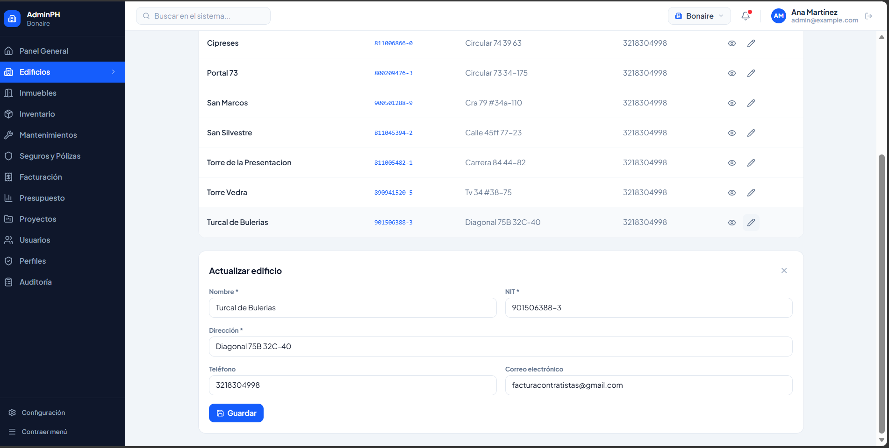

---

## 5. Inmuebles

Registra apartamentos y parqueaderos del edificio, con torre, coeficiente y estado (ocupada, desocupada o inhabitada). A cada unidad se le asocia un responsable de cobro, sin darle acceso al sistema.

**Ejemplo:** apartamento `0301`, torre A, coeficiente `0.0125`, estado ocupada. El responsable es *María López*, identificación `1020304050`.

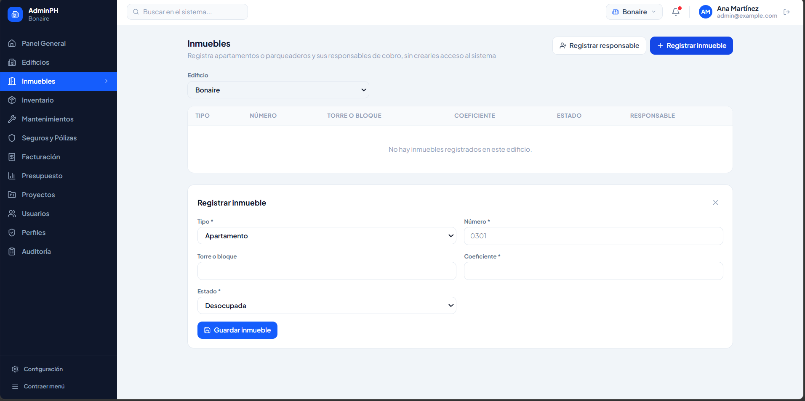
al presionar responsable de cobro se despliega un formulario donde se ponen los datos de la persona responsable de pagar la administracion por parte de un apartamento, por eso se puede seleccionar cualquiera entre todos los registrados anteriormente

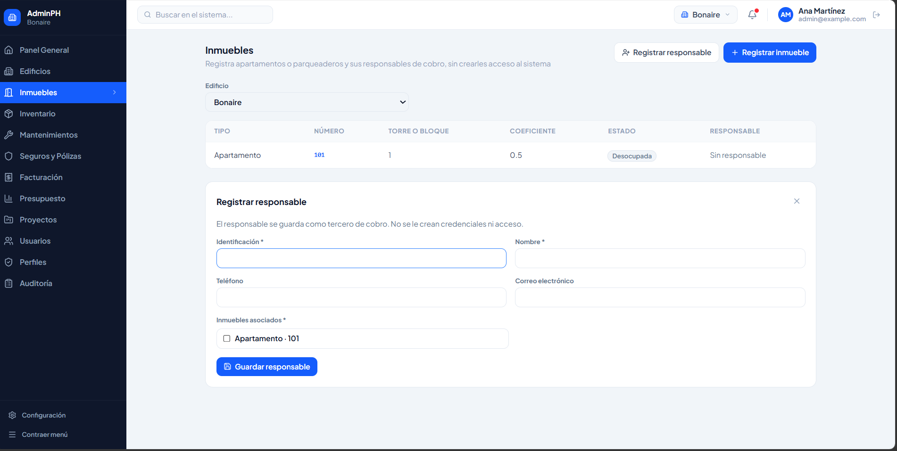

---

## 6. Inventario

Lista los bienes del edificio (código, nombre, tipo, estado y ubicación). Desde el detalle se actualiza el activo, se cambia su estado con un motivo y se consulta el historial. También se asocia un proveedor y se registran el costo de adquisición y los costos posteriores.

**Ejemplo:** activo `ASC-01`, *Ascensor torre A*, tipo electromecánico, ubicación *Torre A*. Pasa a *En mantenimiento* con motivo “falla de puertas”. El costo de adquisición es `$45.000.000`.

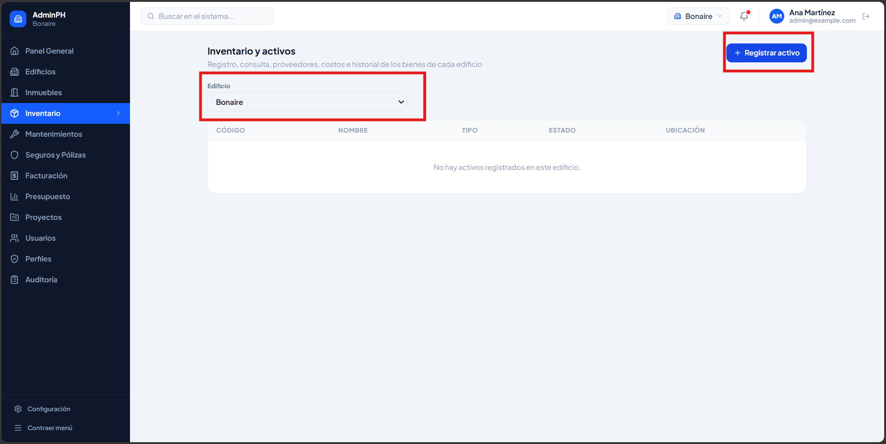
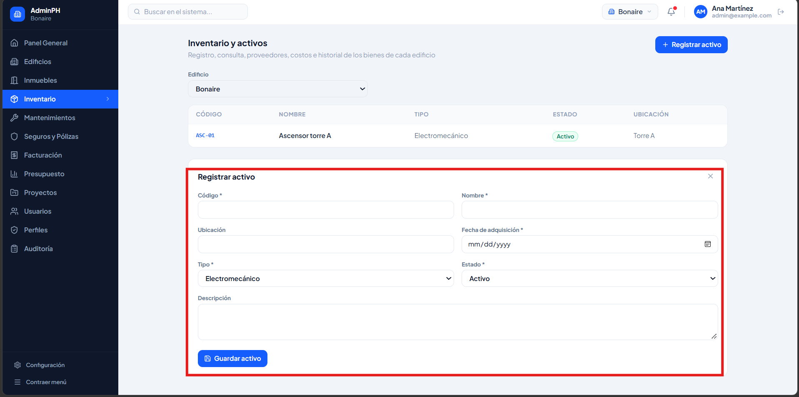

---

## 7. Mantenimientos

Programa intervenciones preventivas o correctivas sobre un activo, con frecuencia y responsable. El historial se filtra por activo. Se puede definir con cuántos días de anticipación avisar y marcar la alerta como atendida.

**Ejemplo:** mantenimiento preventivo mensual del ascensor `ASC-01`, responsable *ServiAscensores*, estado *Programado*.

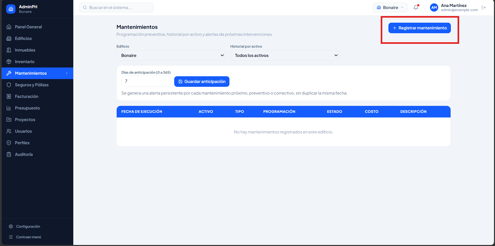
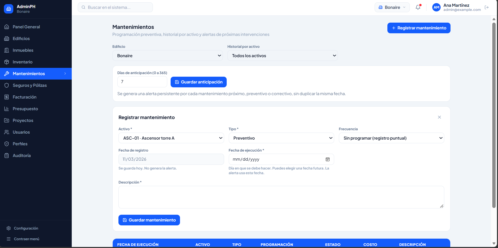
ya con el mantenimiento guardado se pueden establecer dias de anticipacion para la notificacion para saber cual falta.
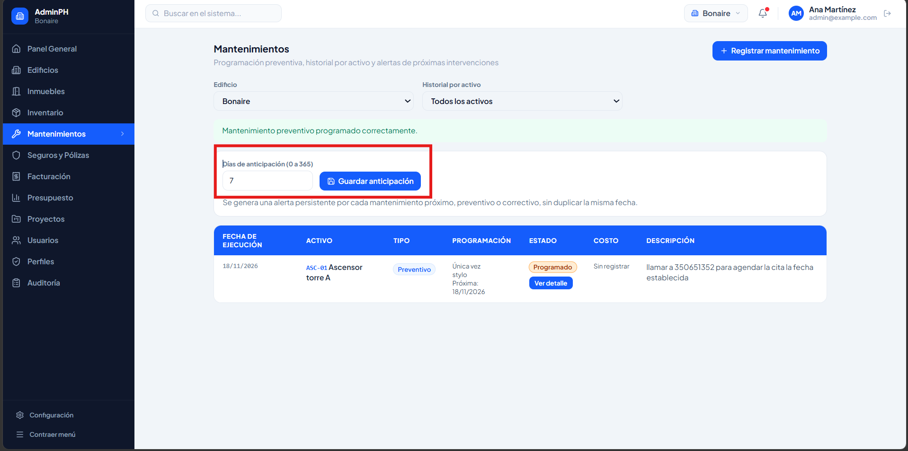

---

## 8. Seguros y pólizas

Tres pestañas:

1. Pólizas Registradas

- **Días de anticipación (0-365):** define con cuántos días de antelación se avisa un vencimiento. Se guarda con *Guardar anticipación*.
- **Contadores:** Vigente, Próxima a vencer, Vencida y Pendiente de inicio.
- **Registrar póliza:** agrega una nueva póliza.
- **Tabla:** Póliza, Aseguradora, Cobertura, Vigencia, Valor asegurado, Estado y Vencimiento.

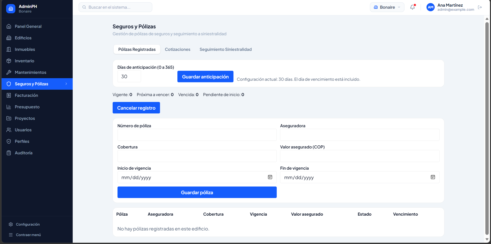

 2. Cotizaciones

- **Formulario:** Aseguradora, Cobertura y Prima (obligatorios), fechas de vigencia y Documento (opcional).
- **Registrar cotización:** guarda la oferta para compararla con otras en la tabla.

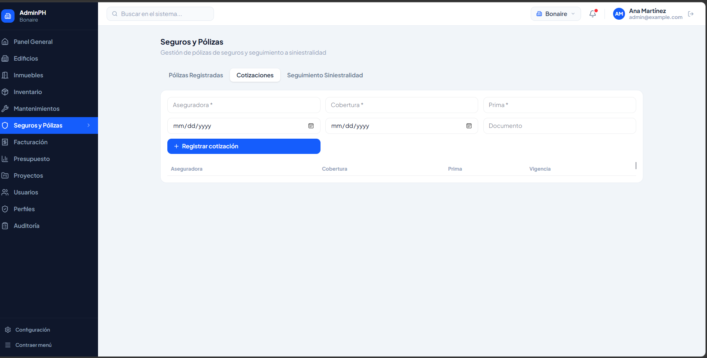

3. Seguimiento Siniestralidad

- **Filtros:** por Póliza y Activo; usar *Filtrar* y *Limpiar*.
- **Registrar reclamación:** abre un nuevo reclamo.
- **Tabla:** Radicado, Fecha, Póliza, Descripción, Activos, Estado, Resultado, Valores, Resolución y Documentos.

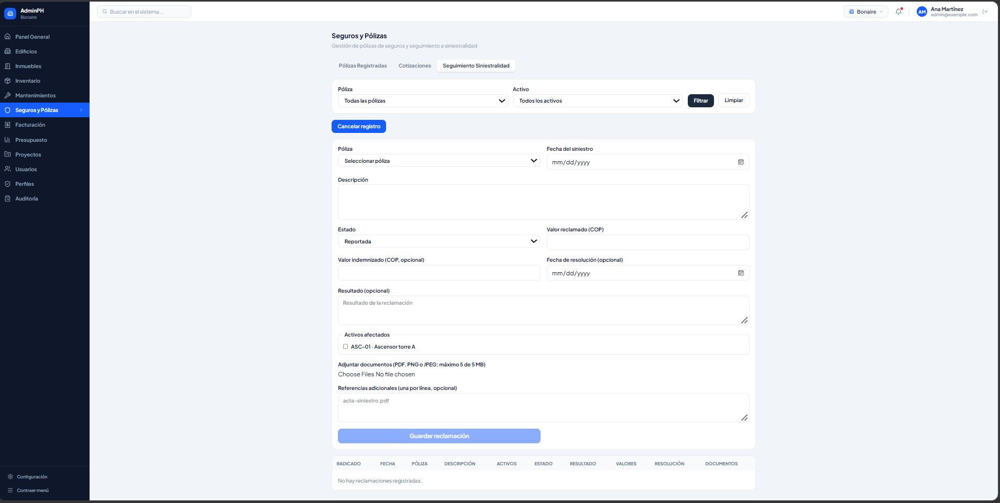

> **Nota:** la información se muestra por edificio, así que confirme que el seleccionado (arriba a la derecha) sea el correcto.

---

## 9. Facturación

Muestra capital facturado, pagos y saldo pendiente. En **Estado de cartera** se ve qué unidades están al día o en mora. En **Historial de facturación** se consultan las facturas. El botón **Registrar pago** aplica un abono a un apartamento (transferencia, efectivo, cheque o PSE).

**Ejemplo:** pago de `$350.000` del apartamento `0301`, medio transferencia, referencia `TRX-88421`, aplicado a las facturas más antiguas.

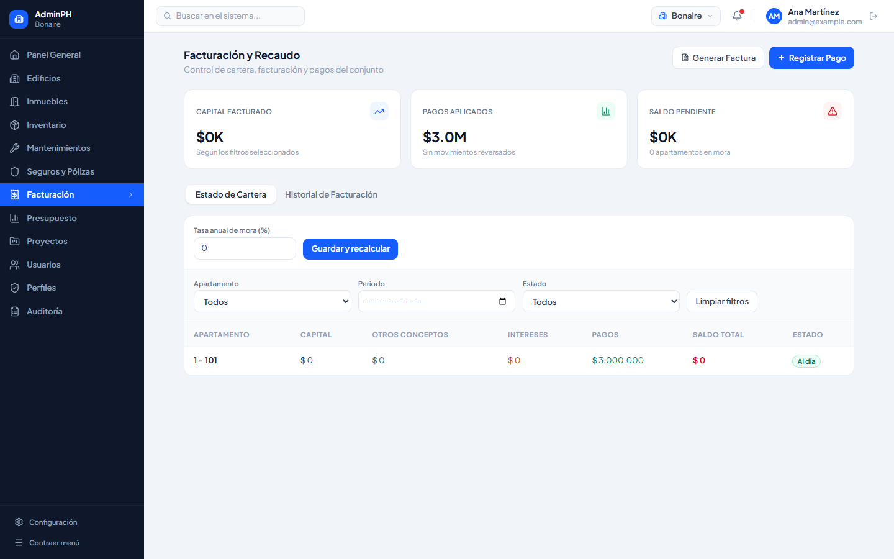

---

## 10. Presupuesto

Arma el presupuesto anual del edificio y registra lo que se va ejecutando por rubro. Permite armar un presupuesto a partir de la ejecución del año anterior, comparar lo aprobado con lo gastado y ver el reporte.

**Ejemplo:** rubro *Mantenimiento de ascensores*, proyectado `$12.000.000`. Se registra una ejecución de `$1.800.000` por la visita de marzo y el disponible baja.

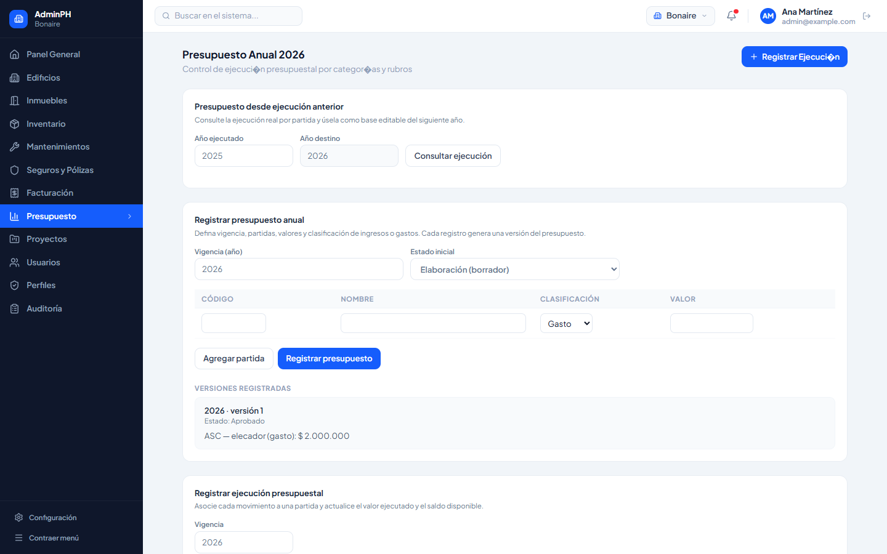

---

## 11. Proyectos

Lista los proyectos del edificio y los filtra por estado, tipo y fechas. Al abrir uno se registran cotizaciones, avances y el cierre, con responsable y documento de soporte.

**Ejemplo:** proyecto *Impermeabilización de cubierta*, tipo obra, responsable *Obras Andinas*, fecha de inicio 1 de marzo y fin 30 de abril. Un avance del 40 % queda con evidencia del acta.

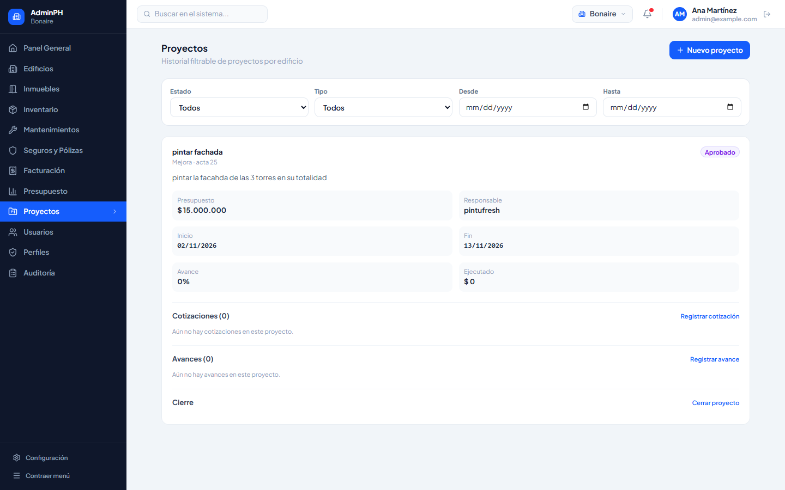

---

## 12. Usuarios

Registra usuarios administrativos (identificación, nombre, correo, contraseña y estado). En la ficha se asignan perfiles y los edificios que puede ver. El correo no se puede repetir.

**Ejemplo:** se crea a *Laura Pérez* (`laura.perez@example.com`) con perfil Operador y solo el edificio El Nogal. Al entrar, su menú queda reducido a ese edificio.

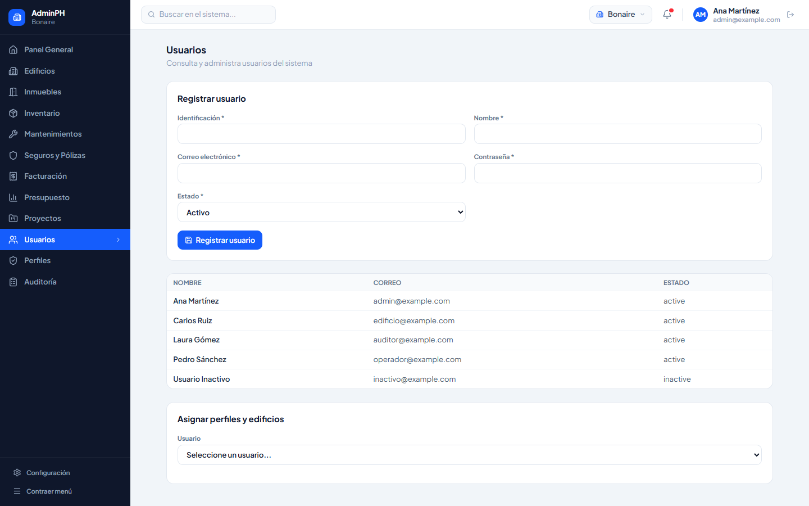

---

## 13. Perfiles

Crea perfiles con nombre, descripción y los permisos que habilitan cada sección del menú.

**Ejemplo:** perfil *Auxiliar de cartera* con permiso de facturación y de consulta de inmuebles, sin acceso a usuarios ni a auditoría.

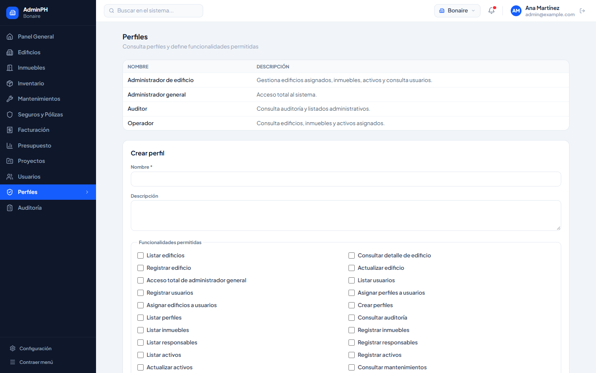

---

## 14. Auditoría

Lista quién hizo cada operación, cuándo, sobre qué entidad y en qué edificio. Se filtra por usuario, fechas, módulo y edificio.

**Ejemplo:** después de registrar el ascensor y cambiar su estado, el filtro por entidad *activo* muestra esas dos operaciones con el usuario Ana Martínez.

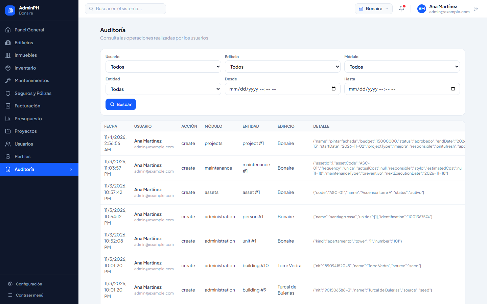
