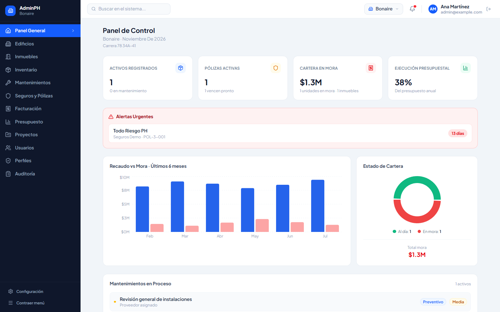
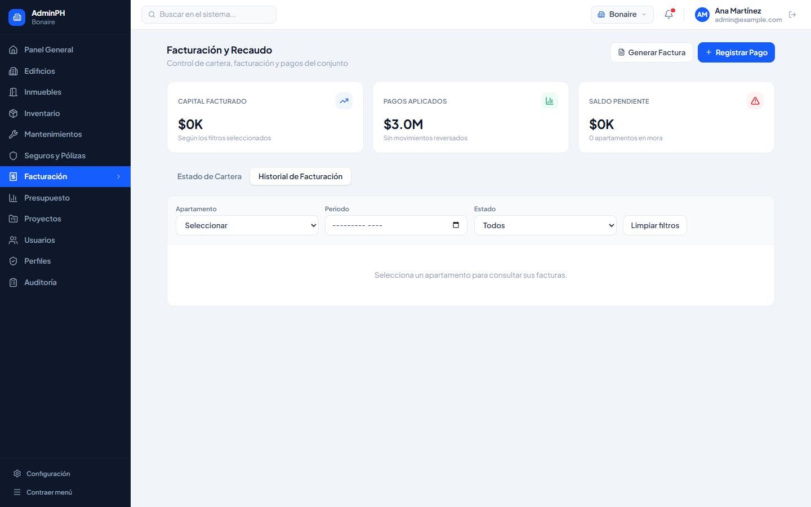
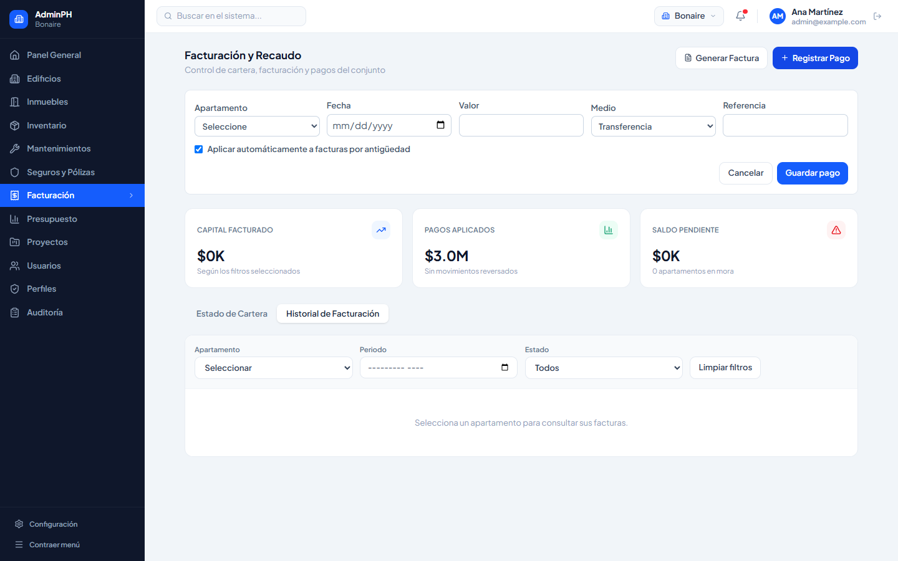
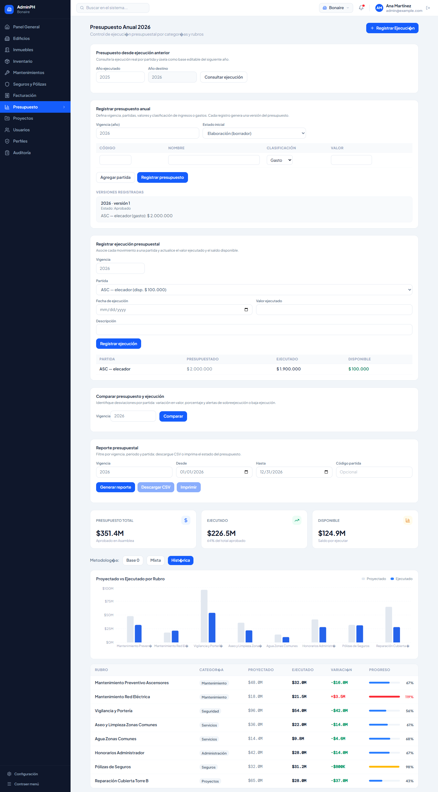
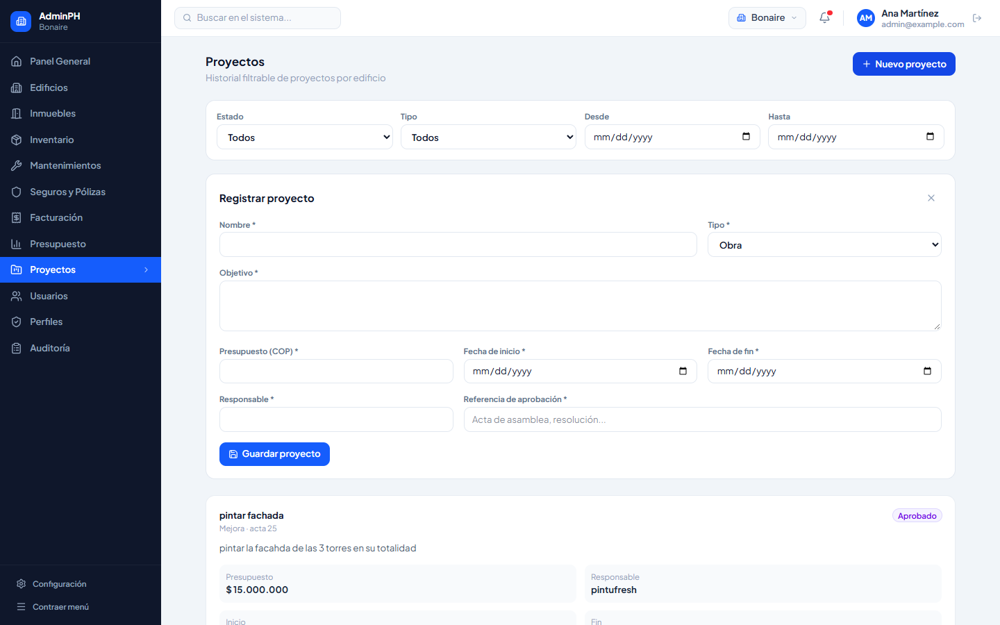
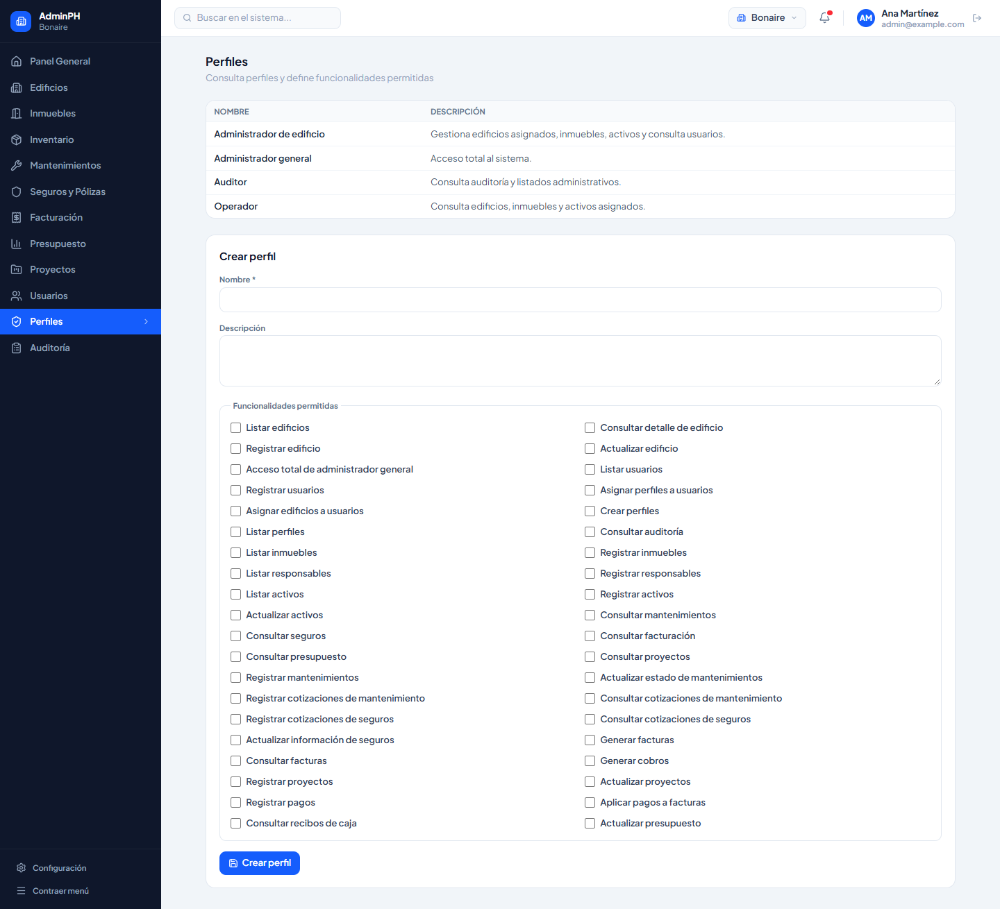

# Funcionalidades de la interfaz

Recorrido breve de AdminPH por cada sección del menú. Cada bloque indica qué hace la pantalla, un ejemplo y el lugar de la captura.

Guarda las imágenes en `docs/capturas/` con el nombre que aparece debajo de cada sección. Si el archivo aún no existe, el enlace se verá roto hasta que lo agregues.

Entra con `admin@example.com` / `Admin123!` y deja seleccionado **Conjunto El Nogal** en la barra superior.

---

## 1. Inicio de sesión

El administrador ingresa con correo y contraseña. Si las credenciales son válidas y el usuario está activo, entra al panel. Desde el nombre en la barra superior puede cerrar sesión.

**Ejemplo:** Ana Martínez entra con `admin@example.com`. El usuario `inactivo@example.com` no puede entrar.

---

## 2. Menú y edificio activo

El menú izquierdo muestra solo las secciones permitidas al perfil. En la barra superior se elige el edificio de trabajo, el resto de pantallas usa ese edificio.

**Ejemplo:** el operador solo ve Panel, Edificios, Inmuebles, Inventario y Mantenimientos. El administrador cambia de El Nogal a Torre Central y el inventario pasa a ser el de esa copropiedad. Se puede cambiar entre edificios suendo superusuario o administrador de varios edificios.

---

## 3. Panel general

Resume el edificio seleccionado: activos, pólizas, cartera en mora y ejecución del presupuesto. También muestra alertas urgentes y un vistazo del recaudo y de los mantenimientos en curso.

**Qué se ve:**

- **Tarjetas superiores:** Activos registrados (con cuántos están en mantenimiento), Pólizas activas (cuántas vencen pronto), Cartera en mora y Ejecución presupuestal del año.
- **Alertas urgentes:** pólizas o vencimientos próximos, con los días restantes.
- **Recaudo vs Mora:** barras de los últimos 6 meses.
- **Estado de cartera:** gráfico con unidades al día y en mora, y el total en mora.
- **Mantenimientos en proceso:** intervenciones activas con tipo y prioridad.

**Ejemplo:** en Bonaire el panel muestra 1 activo registrado, 1 póliza que vence en 13 días y una ejecución presupuestal del 38 %.

---

## 4. Edificios

Lista las copropiedades del usuario. Permite registrar una nueva, ver su detalle y actualizar datos como dirección o teléfono. El NIT no se puede repetir.

**Ejemplo:** se registra *Torre del Parque*, NIT `900222004`, Calle 45 # 12-10. Un segundo intento con el mismo NIT queda rechazado.

El logo de vista da detalles sobre cada edificio, mientras el lapiz permite modificar los documentos. Esta información se muestra en el pie de página.

---

## 5. Inmuebles

Registra apartamentos y parqueaderos del edificio, con torre, coeficiente y estado (ocupada, desocupada o inhabitada). A cada unidad se le asocia un responsable de cobro, sin darle acceso al sistema.

**Ejemplo:** apartamento `0301`, torre A, coeficiente `0.0125`, estado ocupada. El responsable es *María López*, identificación `1020304050`.

al presionar responsable de cobro se despliega un formulario donde se ponen los datos de la persona responsable de pagar la administracion por parte de un apartamento, por eso se puede seleccionar cualquiera entre todos los registrados anteriormente

---

## 6. Inventario

Lista los bienes del edificio (código, nombre, tipo, estado y ubicación). Desde el detalle se actualiza el activo, se cambia su estado con un motivo y se consulta el historial. También se asocia un proveedor y se registran el costo de adquisición y los costos posteriores.

**Ejemplo:** activo `ASC-01`, *Ascensor torre A*, tipo electromecánico, ubicación *Torre A*. Pasa a *En mantenimiento* con motivo “falla de puertas”. El costo de adquisición es `$45.000.000`.

---

## 7. Mantenimientos

Programa intervenciones preventivas o correctivas sobre un activo, con frecuencia y responsable. El historial se filtra por activo. Se puede definir con cuántos días de anticipación avisar y marcar la alerta como atendida.

**Ejemplo:** mantenimiento preventivo mensual del ascensor `ASC-01`, responsable *ServiAscensores*, estado *Programado*.

ya con el mantenimiento guardado se pueden establecer dias de anticipacion para la notificacion para saber cual falta.

---

## 8. Seguros y pólizas

Tres pestañas:

1. Pólizas Registradas

- **Días de anticipación (0-365):** define con cuántos días de antelación se avisa un vencimiento. Se guarda con *Guardar anticipación*.
- **Contadores:** Vigente, Próxima a vencer, Vencida y Pendiente de inicio.
- **Registrar póliza:** agrega una nueva póliza.
- **Tabla:** Póliza, Aseguradora, Cobertura, Vigencia, Valor asegurado, Estado y Vencimiento.

 2. Cotizaciones

- **Formulario:** Aseguradora, Cobertura y Prima (obligatorios), fechas de vigencia y Documento (opcional).
- **Registrar cotización:** guarda la oferta para compararla con otras en la tabla.

3. Seguimiento Siniestralidad

- **Filtros:** por Póliza y Activo; usar *Filtrar* y *Limpiar*.
- **Registrar reclamación:** abre un nuevo reclamo.
- **Tabla:** Radicado, Fecha, Póliza, Descripción, Activos, Estado, Resultado, Valores, Resolución y Documentos.

> **Nota:** la información se muestra por edificio, así que confirme que el seleccionado (arriba a la derecha) sea el correcto.

---

## 9. Facturación

Muestra el control de cartera, facturación y pagos del edificio. Los botones **Generar Factura** y **Registrar Pago** están arriba a la derecha.

- **Tarjetas:** Capital facturado, Pagos aplicados y Saldo pendiente (con cuántos apartamentos están en mora).
- **Pestaña Estado de Cartera:** campo **Tasa anual de mora (%)** con *Guardar y recalcular*. Filtros por Apartamento, Periodo y Estado. La tabla muestra Capital, Otros conceptos, Intereses, Pagos, Saldo total y Estado (*Al día* o *En mora*).

- **Pestaña Historial de Facturación:** se elige un apartamento y se consultan sus facturas, filtrando por periodo y estado. *Limpiar filtros* reinicia la consulta.

- **Registrar Pago:** abre un formulario con Apartamento, Fecha, Valor, Medio (transferencia, efectivo, cheque o PSE) y Referencia. La casilla *Aplicar automáticamente a facturas por antigüedad* abona primero a las facturas más viejas. Se confirma con *Guardar pago*.

**Ejemplo:** pago de `$350.000` del apartamento `101`, medio transferencia, referencia `TRX-88421`, aplicado a las facturas más antiguas.

---

## 10. Presupuesto

Arma el presupuesto anual del edificio, registra lo ejecutado por partida y lo compara con lo aprobado. La página se recorre de arriba hacia abajo:

1. **Presupuesto desde ejecución anterior:** se indica el año ejecutado y el año destino, y *Consultar ejecución* trae el gasto real como base editable.
2. **Registrar presupuesto anual:** vigencia, estado inicial (borrador, etc.) y una tabla de partidas con Código, Nombre, Clasificación (gasto o ingreso) y Valor. *Agregar partida* añade filas y *Registrar presupuesto* guarda. Cada registro crea una versión, listada en **Versiones registradas**.
3. **Registrar ejecución presupuestal:** se elige la partida (se ve el disponible), la fecha, el valor ejecutado y una descripción. La tabla inferior muestra Presupuestado, Ejecutado y Disponible por partida.
4. **Comparar presupuesto y ejecución:** *Comparar* señala desviaciones por partida y alertas de sobreejecución o baja ejecución.
5. **Reporte presupuestal:** filtros por vigencia, periodo y código de partida. Permite *Generar reporte*, *Descargar CSV* e *Imprimir*.
6. **Resultados:** tarjetas de Presupuesto total, Ejecutado y Disponible, selector de metodología (Base 0, Mixta, Histórica), gráfico de Proyectado vs Ejecutado por rubro y tabla con variación y barra de progreso (en rojo si se sobrepasa el 100 %).

El botón **Registrar Ejecución** (arriba a la derecha) lleva directo al formulario de ejecución.

**Ejemplo:** partida `ASC` (ascensor), presupuestada en `$2.000.000`. Tras registrar `$1.900.000` ejecutados, el disponible baja a `$100.000`.

---

## 11. Proyectos

Lista los proyectos del edificio, que se filtran por **Estado**, **Tipo** y rango de fechas **Desde / Hasta**. Cada proyecto es una tarjeta con su estado (por ejemplo *Aprobado*), presupuesto, responsable, fechas de inicio y fin, avance y valor ejecutado.

Dentro de la tarjeta hay tres bloques con su enlace de acción:

- **Cotizaciones:** *Registrar cotización*.
- **Avances:** *Registrar avance* (porcentaje y evidencia).
- **Cierre:** *Cerrar proyecto*.

**Nuevo proyecto** abre el formulario con Nombre, Tipo (obra, mejora, etc.), Objetivo, Presupuesto (COP), Fechas de inicio y fin, Responsable y Referencia de aprobación (acta de asamblea o resolución). Todos son obligatorios.

**Ejemplo:** proyecto *pintar fachada*, tipo mejora, presupuesto `$15.000.000`, responsable *pintufresh*, del 2 al 13 de noviembre, aprobado en el acta 25.

---

## 12. Usuarios

Dos bloques en la misma pantalla:

- **Registrar usuario:** Identificación, Nombre, Correo electrónico, Contraseña y Estado (activo o inactivo), todos obligatorios. El correo no se puede repetir.
- **Tabla de usuarios:** Nombre, Correo y Estado de cada usuario.
- **Asignar perfiles y edificios:** se elige un usuario y se marcan sus perfiles y los edificios que puede ver.

**Ejemplo:** se crea a *Laura Pérez* (`laura.perez@example.com`) con perfil Operador y solo un edificio asignado. Al entrar, su menú se reduce a las secciones del Operador.

---

## 13. Perfiles

Arriba hay una tabla con los perfiles existentes (Administrador general, Administrador de edificio, Auditor y Operador) y su descripción. Debajo está **Crear perfil**: Nombre, Descripción y la lista **Funcionalidades permitidas**, una casilla por permiso (listar edificios, registrar usuarios, consultar auditoría, etc.). Los permisos marcados definen qué secciones aparecen en el menú.

**Ejemplo:** perfil *Auxiliar de cartera* con los permisos de facturación y de listar inmuebles, sin usuarios ni auditoría.

---

## 14. Auditoría

Registra quién hizo cada operación. Los filtros son **Usuario**, **Edificio**, **Módulo**, **Entidad** y rango **Desde / Hasta**; *Buscar* aplica la consulta. La tabla muestra Fecha, Usuario, Acción, Módulo, Entidad, Edificio y el Detalle de los datos guardados.

**Ejemplo:** tras registrar el ascensor `ASC-01` y crear un proyecto, la tabla muestra ambas acciones (*create* en `assets` y en `projects`) a nombre de Ana Martínez, en el edificio Bonaire.
